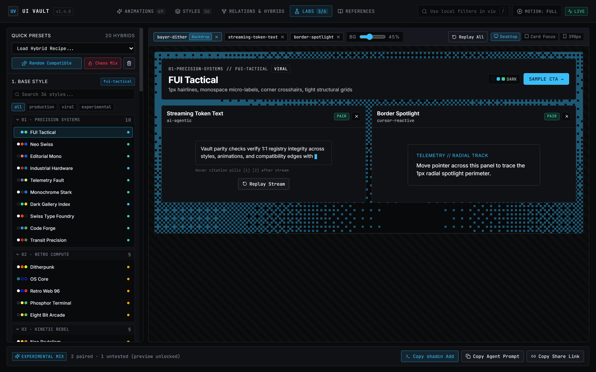
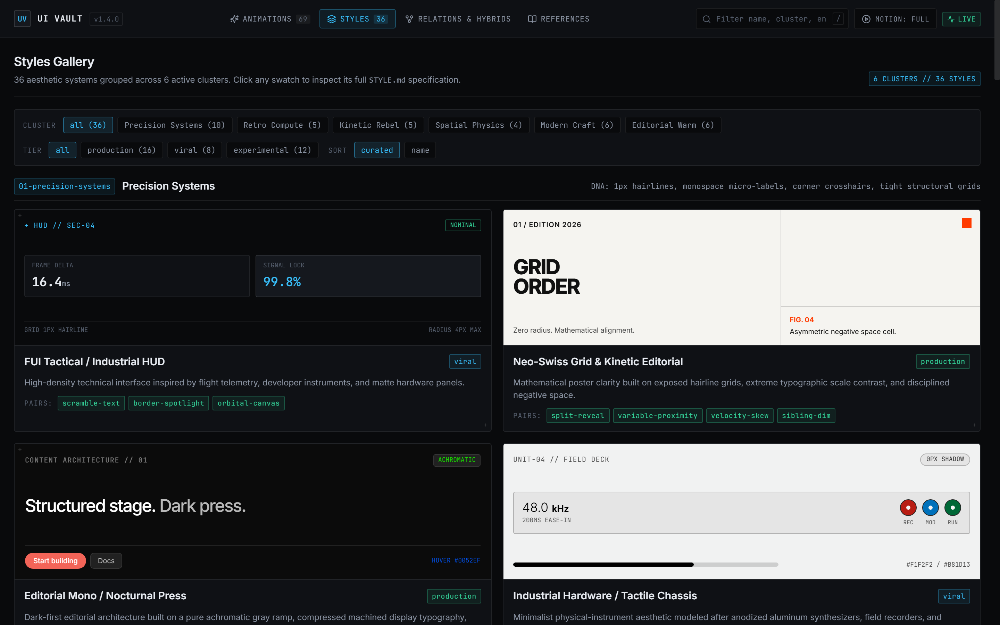
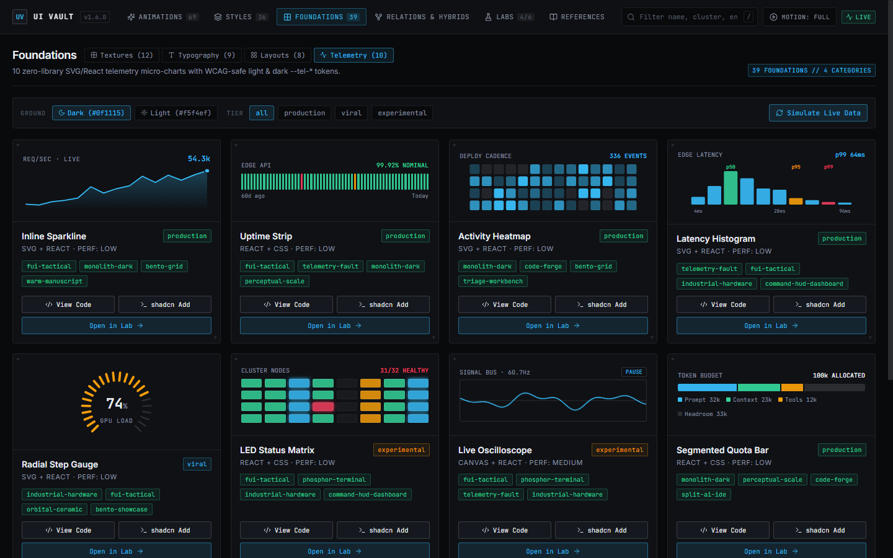

# ui-vault

**6-Layer Design Engineering Toolkit · Live Playground · `shadcn` GitHub Registry · AI Coding Agent Skill**

<!-- VAULT:BADGES:START -->
[](https://aidilzin.github.io/ui-vault/)
[](https://github.com/Aidilzin/ui-vault/actions/workflows/deploy-playground.yml)
[](./relations.json)
[](./LICENSE)
<!-- VAULT:BADGES:END -->

A curated, zero-bloat registry of **144 design primitives** across 6 composable layers—styles, animations, adaptive surface textures, fluid typography, container-query layouts, and zero-library telemetry micro-charts—governed by a machine-readable compatibility graph ([`relations.json`](./relations.json)) and installable directly from GitHub via `shadcn`.

**[Open Live Playground ↗](https://aidilzin.github.io/ui-vault/)** · **[Launch Mix & Match Labs ↗](https://aidilzin.github.io/ui-vault/?tab=labs)** · **[Browse Full Catalog (144)](docs/catalog/styles.md)** · **[Agent Skill Spec](SKILL.md)**

<a href="https://aidilzin.github.io/ui-vault/?tab=labs">
  
</a>

---

## The 6-Layer Stack

<!-- VAULT:OVERVIEW:START -->
| Layer | Items | CLI Prefix | What It Controls | Explore |
| :--- | ---: | :--- | :--- | :--- |
| **Styles** | 43 | `style-*` | Palette, surface elevation, borders, radii & anti-patterns (`STYLE.md` + `tokens.css`) | [Catalog](docs/catalog/styles.md) · [Playground ↗](https://aidilzin.github.io/ui-vault/?tab=styles) |
| **Animations** | 79 | `<name>` | Strict-TS React/CSS/Canvas motion primitives with `prefers-reduced-motion` | [Catalog](docs/catalog/animations.md) · [Playground ↗](https://aidilzin.github.io/ui-vault/) |
| **Textures** | 21 | `texture-*` | Zero-JS adaptive surface & overlay CSS layers (`--tx-color`, `--tx-opacity`) | [Catalog](docs/catalog/foundations.md#textures) · [Playground ↗](https://aidilzin.github.io/ui-vault/?tab=foundations) |
| **Typography** | 16 | `type-*` | Scoped fluid `clamp()` pairings, `tabular-nums` & OpenType rules | [Catalog](docs/catalog/foundations.md#typography) · [Playground ↗](https://aidilzin.github.io/ui-vault/?tab=foundations) |
| **Layouts** | 15 | `layout-*` | Container-query (`@container`) page shells driven by `--lay-*` tokens | [Catalog](docs/catalog/foundations.md#layouts) · [Playground ↗](https://aidilzin.github.io/ui-vault/?tab=foundations) |
| **Telemetry** | 19 | `telemetry-*` | Zero-library SVG/React micro-charts with WCAG-safe `--tel-*` tokens | [Catalog](docs/catalog/foundations.md#telemetry) · [Playground ↗](https://aidilzin.github.io/ui-vault/?tab=foundations) |
<!-- VAULT:OVERVIEW:END -->

---

## Quick Start

### 1. Install Directly via `shadcn` CLI
Pull any combination of styles, layouts, textures, typography, telemetry charts, or animations directly from GitHub—no custom server or npm package required:

```bash
# Compose a multi-layer stack in one command
npx shadcn@latest add Aidilzin/ui-vault/style-fui-tactical Aidilzin/ui-vault/layout-command-hud-dashboard Aidilzin/ui-vault/texture-architect-grid Aidilzin/ui-vault/type-precision-mono Aidilzin/ui-vault/telemetry-live-oscilloscope Aidilzin/ui-vault/scramble-text

# Discover or search all 144 registry items
npx shadcn@latest list Aidilzin/ui-vault && npx shadcn@latest search Aidilzin/ui-vault -q "telemetry"
```

### 2. Attach as an AI Coding Agent Skill
Link this repository into your local skills directory so your agent reads [`SKILL.md`](./SKILL.md) and [`relations.json`](./relations.json) before generating UI:

> **Example Prompt:** `Using ui-vault, style this dashboard with fui-tactical + architect-grid + precision-mono and pair only compatible animations and telemetry from relations.json.`

<details>
<summary>Setup symlinks for Antigravity CLI &amp; Claude Code</summary>

```powershell
# Windows (PowerShell)
New-Item -ItemType Junction -Path "$HOME\.gemini\skills\ui-vault" -Target "C:\projects\ui-vault"
New-Item -ItemType Junction -Path "$HOME\.claude\skills\ui-vault" -Target "C:\projects\ui-vault"
```

```bash
# macOS / Linux
ln -s /path/to/ui-vault ~/.gemini/skills/ui-vault
ln -s /path/to/ui-vault ~/.claude/skills/ui-vault
```

</details>

### 3. Run the Local Playground
```bash
npm install && npm --prefix playground install
npm run dev:playground
```

---

## Flagship Recipes

<!-- VAULT:FEATURED_HYBRIDS:START -->
| Recipe | Multi-Layer Stack | Install Bundle | Live Studio |
| :--- | :--- | :--- | :--- |
| **Tactical Space Dashboard** | `fui-tactical` + lay:`command-hud-dashboard` + tex:`architect-grid` + type:`precision-mono` + tel:`live-oscilloscope` + tel:`node-topology-mini` + `ambient-orbit` + `scramble-text` + `border-spotlight` + `orbital-canvas` | `npx shadcn@latest add Aidilzin/ui-vault/style-fui-tactical Aidilzin/ui-vault/layout-command-hud-dashboard Aidilzin/ui-vault/texture-architect-grid Aidilzin/ui-vault/type-precision-mono Aidilzin/ui-vault/telemetry-live-oscilloscope Aidilzin/ui-vault/telemetry-node-topology-mini Aidilzin/ui-vault/style-ambient-orbit Aidilzin/ui-vault/scramble-text Aidilzin/ui-vault/border-spotlight Aidilzin/ui-vault/orbital-canvas` | [Launch in Labs ↗](https://aidilzin.github.io/ui-vault/?tab=labs&style=fui-tactical&lay=command-hud-dashboard&anims=scramble-text,border-spotlight,orbital-canvas&tpl=landing&tex=architect-grid&texOp=0.14&type=precision-mono&tel=live-oscilloscope,node-topology-mini) |
| **AI Agent Workbench** | `monolith-dark` + lay:`split-ai-ide` + tel:`segmented-quota-bar` + tel:`node-topology-mini` + `reasoning-trace` + `tool-call-step` + `agent-approval-card` + `slash-prompt-composer` | `npx shadcn@latest add Aidilzin/ui-vault/style-monolith-dark Aidilzin/ui-vault/layout-split-ai-ide Aidilzin/ui-vault/telemetry-segmented-quota-bar Aidilzin/ui-vault/telemetry-node-topology-mini Aidilzin/ui-vault/reasoning-trace Aidilzin/ui-vault/tool-call-step Aidilzin/ui-vault/agent-approval-card Aidilzin/ui-vault/slash-prompt-composer` | [Launch in Labs ↗](https://aidilzin.github.io/ui-vault/?tab=labs&style=monolith-dark&lay=split-ai-ide&anims=reasoning-trace,tool-call-step,agent-approval-card,slash-prompt-composer&tpl=workbench&tel=segmented-quota-bar,node-topology-mini) |
| **Bento Product Launch** | `bento-grid` + lay:`bento-showcase` + tel:`inline-sparkline` + tel:`radial-step-gauge` + tel:`diff-delta-pill` + `border-spotlight` + `odometer-ticker` + `scroll-sticky-scale` | `npx shadcn@latest add Aidilzin/ui-vault/style-bento-grid Aidilzin/ui-vault/layout-bento-showcase Aidilzin/ui-vault/telemetry-inline-sparkline Aidilzin/ui-vault/telemetry-radial-step-gauge Aidilzin/ui-vault/telemetry-diff-delta-pill Aidilzin/ui-vault/border-spotlight Aidilzin/ui-vault/odometer-ticker Aidilzin/ui-vault/scroll-sticky-scale` | [Launch in Labs ↗](https://aidilzin.github.io/ui-vault/?tab=labs&style=bento-grid&lay=bento-showcase&anims=border-spotlight,odometer-ticker,scroll-sticky-scale&tpl=landing&tel=inline-sparkline,radial-step-gauge,diff-delta-pill) |
| **Observability Fault Console** | `telemetry-fault` + lay:`command-hud-dashboard` + tel:`uptime-strip` + tel:`latency-histogram` + tel:`diff-delta-pill` + `fui-tactical` + `scramble-text` + `count-up` + `hold-to-confirm` | `npx shadcn@latest add Aidilzin/ui-vault/style-telemetry-fault Aidilzin/ui-vault/layout-command-hud-dashboard Aidilzin/ui-vault/telemetry-uptime-strip Aidilzin/ui-vault/telemetry-latency-histogram Aidilzin/ui-vault/telemetry-diff-delta-pill Aidilzin/ui-vault/style-fui-tactical Aidilzin/ui-vault/scramble-text Aidilzin/ui-vault/count-up Aidilzin/ui-vault/hold-to-confirm` | [Launch in Labs ↗](https://aidilzin.github.io/ui-vault/?tab=labs&style=telemetry-fault&lay=command-hud-dashboard&anims=scramble-text,count-up,hold-to-confirm&tpl=landing&tel=uptime-strip,latency-histogram,diff-delta-pill) |
| **Warm Research Reader** | `warm-manuscript` + tex:`paper-fiber` + type:`literary-humanist` + `archival-paper` + `blur-text` + `scroll-progress-bar` + `make-way-grid` | `npx shadcn@latest add Aidilzin/ui-vault/style-warm-manuscript Aidilzin/ui-vault/texture-paper-fiber Aidilzin/ui-vault/type-literary-humanist Aidilzin/ui-vault/style-archival-paper Aidilzin/ui-vault/blur-text Aidilzin/ui-vault/scroll-progress-bar Aidilzin/ui-vault/make-way-grid` | [Launch in Labs ↗](https://aidilzin.github.io/ui-vault/?tab=labs&style=warm-manuscript&anims=blur-text,scroll-progress-bar,make-way-grid&tpl=editorial&tex=paper-fiber&texOp=0.07&type=literary-humanist) |
| **Type Specimen Press** | `swiss-type-foundry` + lay:`swiss-editorial-grid` + tex:`film-grain` + type:`swiss-grotesk` + tel:`inline-sparkline` + `neo-swiss` + `variable-proximity` + `text-roll` + `marquee-hover-row` | `npx shadcn@latest add Aidilzin/ui-vault/style-swiss-type-foundry Aidilzin/ui-vault/layout-swiss-editorial-grid Aidilzin/ui-vault/texture-film-grain Aidilzin/ui-vault/type-swiss-grotesk Aidilzin/ui-vault/telemetry-inline-sparkline Aidilzin/ui-vault/style-neo-swiss Aidilzin/ui-vault/variable-proximity Aidilzin/ui-vault/text-roll Aidilzin/ui-vault/marquee-hover-row` | [Launch in Labs ↗](https://aidilzin.github.io/ui-vault/?tab=labs&style=swiss-type-foundry&lay=swiss-editorial-grid&anims=variable-proximity,text-roll,marquee-hover-row&tpl=landing&tex=film-grain&texOp=0.09&type=swiss-grotesk&tel=inline-sparkline) |

View all 20 hybrid recipes → [docs/catalog/hybrids.md](docs/catalog/hybrids.md)
<!-- VAULT:FEATURED_HYBRIDS:END -->

---

## Visual Tour

<table width="100%">
  <tr>
    <td width="50%">
      <a href="https://aidilzin.github.io/ui-vault/"></a>
      <br />
      <sub><strong><a href="https://aidilzin.github.io/ui-vault/">Animations Lab ↗</a></strong> — 69 live primitives across 8 motion mechanics with reduced-motion simulation.</sub>
    </td>
    <td width="50%">
      <a href="https://aidilzin.github.io/ui-vault/?tab=styles"></a>
      <br />
      <sub><strong><a href="https://aidilzin.github.io/ui-vault/?tab=styles">Styles Gallery ↗</a></strong> — 36 aesthetic systems across 6 clusters rendered on authentic theme grounds.</sub>
    </td>
  </tr>
  <tr>
    <td width="50%">
      <a href="https://aidilzin.github.io/ui-vault/?tab=foundations"></a>
      <br />
      <sub><strong><a href="https://aidilzin.github.io/ui-vault/?tab=foundations">Foundations ↗</a></strong> — 12 textures, 9 fluid typography systems, 8 container-query layouts, and 10 telemetry charts.</sub>
    </td>
    <td width="50%">
      <a href="https://aidilzin.github.io/ui-vault/?tab=relations"></a>
      <br />
      <sub><strong><a href="https://aidilzin.github.io/ui-vault/?tab=relations">Relations &amp; Hybrids ↗</a></strong> — Compatibility graph highlighting verified pairings and aesthetic clashes.</sub>
    </td>
  </tr>
</table>

---

<details>
<summary>Repository Architecture, Validation &amp; Contributing</summary>

```text
ui-vault/
├── styles/                     # 36 STYLE.md specs & tokens.css across 6 clusters + registry.json
├── animations/                 # 69 strict-TypeScript React/CSS/Canvas primitives + registry.json
├── textures/                   # 12 zero-JS adaptive CSS surface layers + registry.json
├── typography/                 # 9 scoped fluid typography systems + registry.json
├── layouts/                    # 8 container-query (@container) page shells + registry.json
├── telemetry/                  # 10 zero-library SVG/React micro-charts + registry.json
├── docs/catalog/               # Auto-generated 144-item catalog (styles, animations, foundations, hybrids)
├── playground/                 # Live Vite + React + TypeScript app (auto-deployed to GitHub Pages)
├── scripts/                    # check-vault.mjs (parity) & sync-readme.mjs (README + docs/catalog)
├── relations.json              # Machine-readable v1.6.0 compatibility graph across all 6 layers
├── registry.json               # Root shadcn registry manifest (7 manifests, 144 items)
└── SKILL.md                    # 6-layer agent workflow & repeatable ingestion guidelines
```

Run all local verification gates before pushing to `main`:

```bash
npm run sync:readme        # Regenerates README.md blocks & docs/catalog/*.md
npm run typecheck          # Strict TypeScript check across animations/, layouts/, telemetry/
npm run validate:registry  # Validates all 7 shadcn registry manifests (144 items)
npm run check:vault        # Enforces 1:1 parity across relations.json, registries & disk
npm run build:playground   # Production Vite + TypeScript bundle
```

See [`SKILL.md`](./SKILL.md) for the repeatable ingestion pipeline across all 6 layers.

</details>

Released under the [MIT License](./LICENSE).
