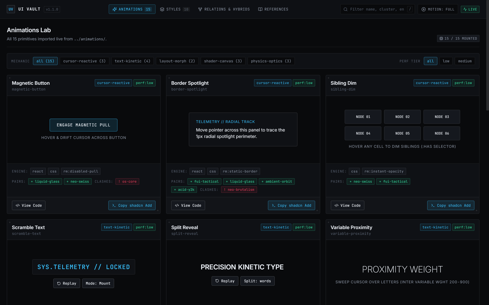
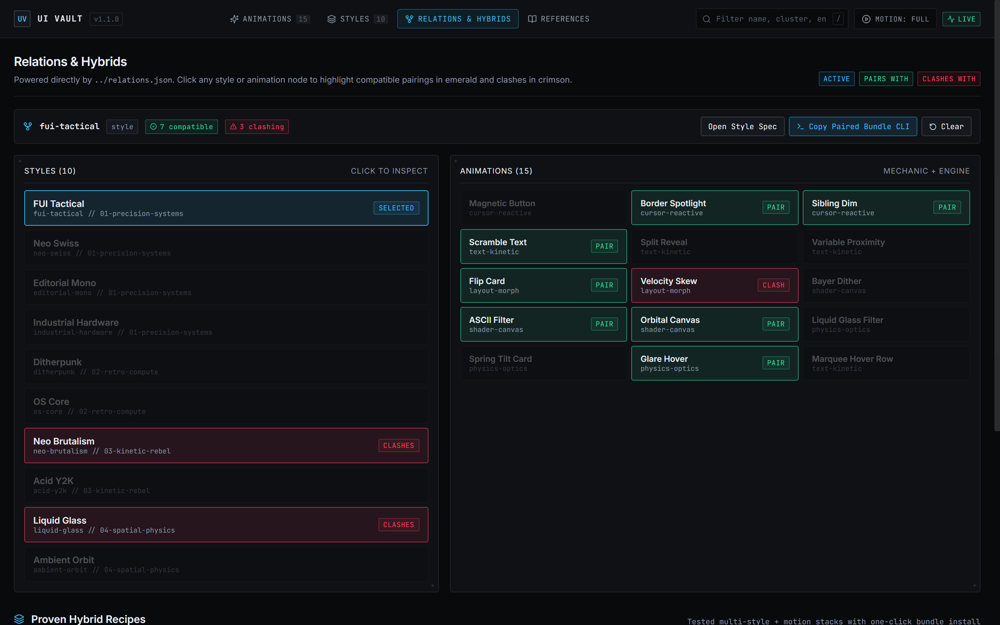

# ui-vault

**Experimental UI Style Vault · `shadcn` GitHub Registry · AI Agent Skill**

[](https://aidilzin.github.io/ui-vault/)
[](https://github.com/Aidilzin/ui-vault/actions/workflows/deploy-playground.yml)
[](./relations.json)
[](./LICENSE)

A curated, zero-bloat collection of experimental UI style specifications, CSS token files, strict-TypeScript React animations, and a machine-readable compatibility graph (`relations.json`). Every animation ships with an explicit `prefers-reduced-motion` fallback and installs directly from GitHub with zero build server required.

<a href="https://aidilzin.github.io/ui-vault/">
  
</a>

---

## Three Ways to Use `ui-vault`

### 1. Install Directly via `shadcn` CLI

Pull any style spec (`STYLE.md` + `tokens.css`) or animation component directly from GitHub — no custom server or npm package needed:

```bash
# List every item in the registry
npx shadcn@latest list Aidilzin/ui-vault

# Search by aesthetic cluster or motion mechanic
npx shadcn@latest search Aidilzin/ui-vault -q "optics"

# Install a style spec + token sheet or an animation primitive
npx shadcn@latest add Aidilzin/ui-vault/style-fui-tactical
npx shadcn@latest add Aidilzin/ui-vault/orbital-canvas
```

### 2. Attach as an AI Coding Agent Skill

Link this repository into your local skills directory so your coding agent automatically reads [`SKILL.md`](./SKILL.md) and [`relations.json`](./relations.json) before writing UI code:

**Windows (PowerShell)**

```powershell
# Antigravity CLI
New-Item -ItemType Junction -Path "$HOME\.gemini\skills\ui-vault" -Target "C:\projects\ui-vault"

# Claude Code
New-Item -ItemType Junction -Path "$HOME\.claude\skills\ui-vault" -Target "C:\projects\ui-vault"
```

**macOS / Linux**

```bash
# Antigravity CLI
ln -s /path/to/ui-vault ~/.gemini/skills/ui-vault

# Claude Code
ln -s /path/to/ui-vault ~/.claude/skills/ui-vault
```

**Example Agent Prompt:**
> `Using ui-vault, style this dashboard with fui-tactical and pair it only with compatible animations from relations.json.`

### 3. Run the Local Interactive Playground

Inspect all 10 styles, 15 live animations, compatibility pairings, reduced-motion fallbacks, and curated references locally:

```bash
npm install
npm --prefix playground install
npm run dev:playground
```

---

## Live Catalog

### Styles by Aesthetic Cluster (10)

| Cluster | Cluster DNA | Style ID | Key Pairings | `shadcn` Install |
| :--- | :--- | :--- | :--- | :--- |
| `01-precision-systems` | 1px hairlines, monospace micro-labels, corner crosshairs, tight structural grids | `fui-tactical` | `scramble-text`, `border-spotlight`, `orbital-canvas` | `npx shadcn@latest add Aidilzin/ui-vault/style-fui-tactical` |
| `01-precision-systems` | 1px hairlines, monospace micro-labels, corner crosshairs, tight structural grids | `neo-swiss` | `split-reveal`, `variable-proximity`, `velocity-skew`, `sibling-dim` | `npx shadcn@latest add Aidilzin/ui-vault/style-neo-swiss` |
| `01-precision-systems` | 1px hairlines, monospace micro-labels, corner crosshairs, tight structural grids | `editorial-mono` | `split-reveal`, `variable-proximity`, `border-spotlight`, `sibling-dim` | `npx shadcn@latest add Aidilzin/ui-vault/style-editorial-mono` |
| `01-precision-systems` | 1px hairlines, monospace micro-labels, corner crosshairs, tight structural grids | `industrial-hardware` | `flip-card`, `magnetic-button`, `sibling-dim`, `scramble-text` | `npx shadcn@latest add Aidilzin/ui-vault/style-industrial-hardware` |
| `02-retro-compute` | 1-bit dithering, ASCII/glyph grids, vintage window chrome, CRT grain | `ditherpunk` | `bayer-dither`, `scramble-text`, `ascii-filter` | `npx shadcn@latest add Aidilzin/ui-vault/style-ditherpunk` |
| `02-retro-compute` | 1-bit dithering, ASCII/glyph grids, vintage window chrome, CRT grain | `os-core` | `scramble-text`, `flip-card`, `bayer-dither` | `npx shadcn@latest add Aidilzin/ui-vault/style-os-core` |
| `03-kinetic-rebel` | Oversized expressive display type, hard zero-blur shadows, raw grids, chrome accents | `neo-brutalism` | `velocity-skew`, `variable-proximity`, `bayer-dither`, `split-reveal` | `npx shadcn@latest add Aidilzin/ui-vault/style-neo-brutalism` |
| `03-kinetic-rebel` | Oversized expressive display type, hard zero-blur shadows, raw grids, chrome accents | `acid-y2k` | `variable-proximity`, `velocity-skew`, `ascii-filter`, `border-spotlight` | `npx shadcn@latest add Aidilzin/ui-vault/style-acid-y2k` |
| `04-spatial-physics` | Optical refraction, depth sorting, mass/inertia springs, specular lighting | `liquid-glass` | `liquid-glass-filter`, `magnetic-button`, `spring-tilt-card`, `border-spotlight` | `npx shadcn@latest add Aidilzin/ui-vault/style-liquid-glass` |
| `04-spatial-physics` | Optical refraction, depth sorting, mass/inertia springs, specular lighting | `ambient-orbit` | `orbital-canvas`, `border-spotlight`, `scramble-text` | `npx shadcn@latest add Aidilzin/ui-vault/style-ambient-orbit` |

### Animations by Mechanic (15)

| Animation | Mechanic | Engine | Perf Tier | Reduced Motion Fallback | Registry Item |
| :--- | :--- | :--- | :--- | :--- | :--- |
| Magnetic Button | `cursor-reactive` | `react`, `css` | `low` | `disabled-pull` | `magnetic-button` |
| Mouse-Tracking Border Spotlight | `cursor-reactive` | `react`, `css` | `low` | `static-border` | `border-spotlight` |
| Sibling Dim Grid | `cursor-reactive` | `css` | `low` | `instant-opacity` | `sibling-dim` |
| Scramble / Decrypt Text | `text-kinetic` | `react` | `low` | `instant-text-swap` | `scramble-text` |
| Masked Split-Text Reveal | `text-kinetic` | `react`, `css` | `low` | `instant-visible` | `split-reveal` |
| Variable Font Proximity | `text-kinetic` | `react`, `css` | `low` | `static-weight` | `variable-proximity` |
| Kinetic Marquee Hover Row | `text-kinetic` | `react`, `css` | `low` | `static-highlight` | `marquee-hover-row` |
| FLIP Layout Morph Card | `layout-morph` | `react`, `waapi` | `low` | `instant-layout` | `flip-card` |
| Scroll Velocity Skew | `layout-morph` | `react` | `low` | `disabled-skew` | `velocity-skew` |
| Bayer Dither Canvas | `shader-canvas` | `canvas` | `medium` | `static-dither-frame` | `bayer-dither` |
| ASCII Wave Filter | `shader-canvas` | `react` | `low` | `static-ascii-frame` | `ascii-filter` |
| 2.5D Orbital Constellation Canvas | `shader-canvas` | `canvas` | `medium` | `static-constellation` | `orbital-canvas` |
| Liquid Glass Surface | `physics-optics` | `svg`, `css` | `medium` | `opaque-fallback` | `liquid-glass-filter` |
| Spring 3D Tilt Card | `physics-optics` | `react`, `css` | `low` | `flat-card` | `spring-tilt-card` |
| Specular Glare Hover | `physics-optics` | `react`, `css` | `low` | `static-surface` | `glare-hover` |

### Proven Hybrid Recipes (3)

| Recipe | Stack (`baseStyle` + `accents`) | Best For | Combined `shadcn` Install |
| :--- | :--- | :--- | :--- |
| **Tactical Space Dashboard** (`tactical-space`) | `fui-tactical` + `ambient-orbit`, `scramble-text`, `border-spotlight`, `orbital-canvas` | Developer dashboards, telemetry maps, CLI/workspace visualizers | `npx shadcn@latest add Aidilzin/ui-vault/style-fui-tactical Aidilzin/ui-vault/style-ambient-orbit Aidilzin/ui-vault/scramble-text Aidilzin/ui-vault/border-spotlight Aidilzin/ui-vault/orbital-canvas` |
| **Editorial Dither Brutalism** (`editorial-dither`) | `neo-brutalism` + `ditherpunk`, `bayer-dither`, `velocity-skew` | Portfolios, interactive essays, experimental landing pages | `npx shadcn@latest add Aidilzin/ui-vault/style-neo-brutalism Aidilzin/ui-vault/style-ditherpunk Aidilzin/ui-vault/bayer-dither Aidilzin/ui-vault/velocity-skew` |
| **Precision Optical HUD** (`precision-glass`) | `fui-tactical` + `liquid-glass`, `liquid-glass-filter`, `magnetic-button` | Floating command palettes, spatial toolbars, audio/hardware web apps | `npx shadcn@latest add Aidilzin/ui-vault/style-fui-tactical Aidilzin/ui-vault/style-liquid-glass Aidilzin/ui-vault/liquid-glass-filter Aidilzin/ui-vault/magnetic-button` |

---

## Visual Gallery

<table>
  <tr>
    <td width="50%">
      
      <br />
      <sub><strong>Styles Gallery</strong> — 10 aesthetic systems rendered on their own authentic theme ground with slide-over <code>STYLE.md</code> specs.</sub>
    </td>
    <td width="50%">
      
      <br />
      <sub><strong>Relations &amp; Hybrids</strong> — Interactive compatibility graph highlighting valid pairings (emerald) and aesthetic clashes (crimson).</sub>
    </td>
  </tr>
</table>

---

## Repository Map & Validation

```text
ui-vault/
├── animations/                 # 15 strict-TypeScript React/CSS/Canvas primitives + registry.json
├── styles/                     # 10 STYLE.md specs & tokens.css across 4 clusters + registry.json
├── playground/                 # Live Vite + React + TypeScript browser app (auto-deployed to Pages)
├── docs/assets/                # README preview captures
├── references/bookmarks.md     # Curated experimental design galleries & motion archives
├── relations.json              # Machine-readable clusters, pairings, clashes, hybrids & registries
├── registry.json               # Root shadcn registry manifest
├── SKILL.md                    # Agent workflow & repeatable style/animation ingestion pipeline
└── .agents/mcp_config.json     # Dembrandt MCP config for live-URL design token extraction
```

Run all three verification gates locally before pushing to `main` (GitHub Actions runs the same checks before deploying `playground/dist` to GitHub Pages):

```bash
npm run typecheck
npm run validate:registry
npm run build:playground
```

See [`SKILL.md`](./SKILL.md) for the repeatable ingestion workflow covering Open Registries, `DESIGN.md` repositories, Creative Coding Labs, and live-URL token extraction via Dembrandt MCP.
